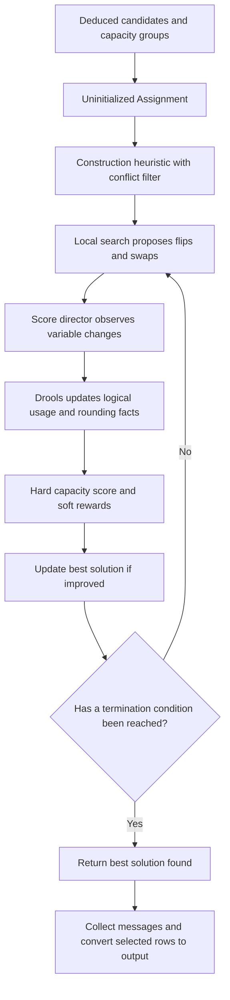

# Optimization Phase

## Purpose and Phase Boundary

In `subscription-matcher`, the [deduction phase](deduction-phase.md) produces eligible candidate coverage groups. Optimization selects a combination of those groups, taking overlap, subscription capacity, and allocation preferences into account.

[Matcher.java](../src/main/java/com/suse/matcher/Matcher.java) creates one planning `Match` per distinct `PotentialMatch.groupId`, computes conflict sets from candidates covering the same system/product pair, and supplies these together with the deduced facts in an `Assignment`.

For a domain-level introduction to policies, candidate matches, and capacity accounting, see the [business logic overview](business-logic.md).

OptaPlanner is a constraint solver: it explores alternative values of planning variables and compares their scores. Each `Match` represents one `groupId`, and its `confirmed` value makes the choice for that group: `true` selects every `PotentialMatch` row in the group, while `false` selects none. This is not an independent decision for every system/subscription pair. For example, unlimited-virtualization host coverage and its free guest rows can share a group, as can the base and add-on rows of an inherited-virtualization option.

Three parts of the implementation play different roles. Deduction rules produce the candidate rows and group them. Optimization score rules evaluate the current selection, rewarding covered installations and preferences while penalizing subscription-capacity overuse. Conflict filters and move classes prevent overlapping groups from remaining selected together and define the changes the solver can try, such as flipping one group or swapping groups. The solver compares the resulting scores to choose among the allocations it explores; it does not invent new candidate assignments outside those groups.

## OptaPlanner Concepts Used Here

The current [pom.xml](../pom.xml) targets Java 17 and sets both Drools and OptaPlanner to `10.2.0`. This implementation uses DRL scoring through `HardSoftScoreHolder`, not Constraint Streams.

| Concept | Implementation | Plain-language meaning |
| --- | --- | --- |
| Planning solution | [Assignment.java](../src/main/java/com/suse/matcher/optimization/Assignment.java), `@PlanningSolution` | A complete candidate allocation, its facts, and its score. |
| Planning entity | [Match.java](../src/main/java/com/suse/matcher/optimization/Match.java), `@PlanningEntity` | One all-or-nothing candidate group whose selection can change. |
| Planning variable | `Match.confirmed`, `@PlanningVariable` | `true` selects all candidate rows in that group; `false` selects none. Initial null means not initialized yet. |
| Value range | `Assignment.getBooleans()` | The possible assigned values, in declared order: false, then true. |
| Problem facts | `Assignment.problemFacts`, `@ProblemFactCollectionProperty` | Deduced topology, subscriptions, candidates, capacity groups, installed requirements, pins, and messages. The solver does not plan their values. |
| Score | `Assignment.score`, `@PlanningScore` | `HardSoftScore`: feasibility first, preferences second. |
| Score director | OptaPlanner's DRL score director | Maintains rule-engine state and recalculates the effects of planning-variable changes. |
| Move | `MatchMove` or construction `ChangeMove` | A proposed change to one or more selection flags. |

The deduced facts are loaded into the score director's own Drools state. This is separate from the deduction session, which has already closed. Scoring rules continuously reflect the current working allocation; they do not rerun the six deduction stages.

The conflict map and sorted candidate cache are supporting data for move generation, not additional scored problem-fact collections. A conflict means two distinct groups cover the same `(systemId, productId)`. Subscription capacity competition is a different relationship and is checked by scoring.



Local search stops when a configured termination condition is met, including reaching a configured number of iterations without improving the best-known solution. Please check the current OptaPlanner solver configuration for the termination setup.

## How Scores Are Compared

OptaPlanner's `HardSoftScore` keeps two kinds of score separate instead of converting every rule into one weighted total:

| Score level | What it means here | How to read it |
| --- | --- | --- |
| Hard | Subscription-capacity feasibility, calculated by `dontExceedSubscriptionCount`. | Zero means no subscription exceeds its modeled capacity; a negative value records overuse. Higher is better. |
| Soft | Preferences from the coverage, pin, and bundle reward rules. | A larger value means the allocation satisfies more or stronger preferences. It does not establish capacity feasibility. |

For initialized solutions, OptaPlanner compares scores lexicographically: it compares hard scores first and consults the soft score only when the hard scores tie. This means no number of soft points can compensate for a hard-capacity violation. Within a level, contributions from its rule matches are added together; the levels themselves are not added to each other. In this guide, a shorthand such as `0hard/100soft` shows both levels for an initialized solution.

- `0hard/100000soft` beats `-1hard/1000000soft`: the feasible solution wins even though the infeasible one has more soft points.
- `0hard/210soft` beats `0hard/200soft`: when both allocations are feasible, the higher soft reward wins.
- If both allocations have the same hard and soft scores, the score does not distinguish them; solver ordering or search history may determine which equivalent-scoring solution is retained.

There is also an initialization score while planning variables are still unset. Each `Match.confirmed` starts as `null`, meaning OptaPlanner has not assigned it yet; the declared business choices are only `false` and `true`. A solution with uninitialized variables has a negative initialization score and ranks below an otherwise comparable fully initialized solution. After the construction heuristic assigns every variable, initialization score is zero and the hard/soft comparison above determines the ranking.

The sole explicit hard constraint in [Scores.drl](../src/main/resources/com/suse/matcher/optimization/rules/Scores.drl) checks subscription usage. There is no score rule penalizing double coverage. Avoiding double coverage is an invariant maintained by the construction filter and custom moves. A new move implementation that ignores conflicts would not be made safe by the current score rules.

Uncovered installations are allowed: their effect is a missing soft reward, not a negative hard score. An all-false initialized allocation has score zero on both levels for normal non-negative subscription quantities, so the search has a feasible baseline.

## Scoring Fact Lifecycle

The first three scoring rules insert intermediate facts with `insertLogical`. This is Drools truth maintenance: a fact remains present while at least one rule activation supports it, and disappears automatically once all supporting conditions cease to hold.

This matters when a trial move is undone. Deselecting a group removes unsupported usage facts; selecting it restores them. The application does not manually delete every penalty on every move. Likewise, the score holder registers score contributions against rule activations and retracts them when those activations cease to apply, rather than accumulating stale rewards forever.

### Ordinary Usage: `penaltyForExceededMatches`

For each selected `PotentialMatch` and its `CentGroup`, the rule logically inserts:

```java
new Penalty(subscriptionId, -centGroupId, cents)
```

Despite its name, this rule creates usage facts for all selected coverage, not only for over-capacity allocations. A `Penalty` is therefore an accounting item; it is not itself a negative score contribution.

[Penalty.java](../src/main/java/com/suse/matcher/optimization/facts/Penalty.java) defines equality by subscription ID, penalty-group ID, and cents. Equal logical insertions share an accounting fact and its justifications. Consequently, rows referencing the same charge for a subscription do not multiply that charge, even if they belong to different selected candidate groups. Zero-cent guest rows still have usage facts but add no capacity consumption.

The negated cent-group ID distinguishes ordinary charge keys from the non-negated topology-group keys used by ONE_TWO rounding; generated IDs start at zero, so this is an implementation convention rather than two formally disjoint numeric ranges.

### ONE_TWO Membership: `calculate12Penalties`

For a non-ignored ONE_TWO subscription, a selected candidate row on a guest that belongs to a `PenaltyGroup` logically inserts:

```java
new ConfirmedMatchInPenaltyGroup(subscriptionId, penaltyGroupId, guestId)
```

[ConfirmedMatchInPenaltyGroup.java](../src/main/java/com/suse/matcher/optimization/facts/ConfirmedMatchInPenaltyGroup.java) includes all three fields in equality. Multiple selected product rows for the same guest/subscription/group therefore count as one guest membership for rounding, not one membership per product.

Penalty groups come from deduction: explicit virtualization groups where present, otherwise host-derived groups. A guest with explicit membership is not additionally given a fallback host-derived group. If input places a guest in several explicit groups, each membership is available to the scoring rules.

### Odd-Guest Rounding: `insert12Penalties`

For each subscription and penalty group, this rule counts logically supported memberships. If the count is odd, it inserts:

```java
new OneTwoPenalty(subscriptionId, penaltyGroupId, 50)
```

[OneTwoPenalty.java](../src/main/java/com/suse/matcher/optimization/facts/OneTwoPenalty.java) extends `Penalty`, so the hard capacity rule sums it with ordinary usage. It rounds a group's half-unit guest usage up to a whole unit. With one 50-cent charge per guest, a group containing $n$ selected guests consumes:

$$
U_{group}=50n+50(n\bmod 2)=100\left\lceil\frac{n}{2}\right\rceil.
$$

This formula describes the simple one-charge-per-guest case. The general implementation sums all distinct charge facts and then adds odd-membership rounding; bundle charge sharing and multi-product cases must be interpreted through those facts.

| Selected guests | Topology | Ordinary usage | Rounding | Total usage |
| --- | --- | --- | --- | --- |
| 1 | One penalty group | 50 | 50 | 100 |
| 2 | Same penalty group | 100 | 0 | 100 |
| 3 | Same penalty group | 150 | 50 | 200 |
| 2 | One guest in each of two penalty groups | 100 | 100 | 200 |

Thus a quantity-1 subscription can cover two guests in the same group but not one guest in each of two different groups. Moving a guest can remove one odd-group penalty and create another, so equal-looking 50-cent candidates do not necessarily have the same allocation effect.

## Hard Capacity Rule

`dontExceedSubscriptionCount` sums `Penalty.cents`, including ONE_TWO subclasses, for each non-ignored subscription.

For ordinary quantities, available capacity is $A=100q$, where $q$ is purchased quantity. If quantity is `Integer.MAX_VALUE`, the code uses that value directly instead of multiplying by 100. It is a special finite integer capacity sentinel, not mathematical infinity.

Let $U$ be total used cents. The subscription contributes:

$$
H_s=\begin{cases}
0 & U\le A,\\
-10+\operatorname{trunc}(9A/U) & U>A.
\end{cases}
$$

The arithmetic uses Java integers; for non-negative capacity and positive overuse, truncation is the same as rounding down. Total hard score is the sum of these per-subscription contributions. The calculation assumes domain-appropriate values and is not a separate guard against arbitrary integer overflow in input quantities or usage.

For a quantity-1 subscription:

| Used cents | Available cents | Hard contribution |
| --- | --- | --- |
| 100 | 100 | 0 |
| 150 | 100 | -4 |
| 200 | 100 | -6 |
| 1000 | 100 | -10 |

The bounded negative contribution gives the search a gradient among infeasible allocations without allowing any infeasible allocation to beat a feasible one through soft rewards. It does not directly penalize unused capacity or charge a soft cost for using a subscription.

The score-rule comment says hard violations must never appear in a produced solution. That is the intended outcome of the feasible construction baseline and best-solution tracking, not a ban on evaluating temporarily infeasible trial moves. The facade does not perform a separate final hard-score rejection.

## Soft Reward Rules

### `maximizeCoveredInstallations`: +100

Each join of an `InstalledProduct`, a corresponding `PotentialMatch`, and a selected `Match` earns 100 points. Coverage is scored per system/product installation, not per system and not per purchased subscription unit. A selected group covering several installations can therefore earn several hundreds of points.

A hosted-only host candidate is not rewarded merely for existing: it must join an actual `InstalledProduct`. Conversely, an unlimited-virtualization group can earn rewards for several installed guest products even though their incremental capacity charge is zero.

The rule relies on conflict-safe moves to prevent distinct groups from simultaneously earning coverage rewards for the same installation.

### `maximizePinnedMatches`: +10

A `PinnedMatch(systemId, subscriptionId)` joins selected candidate rows with the same system and subscription and earns 10 points per matching rule activation. Because a pin has no product ID, a selected group with several matching product rows can earn multiple pin rewards for the same input pin.

Pins are not mandatory. They can lose to capacity feasibility, greater coverage, or the aggregate rewards of another allocation. After solving, [MessageCollector.java](../src/main/java/com/suse/matcher/optimization/MessageCollector.java) emits `unsatisfied_pinned_match` when no selected output row uses the pinned system/subscription pair.

An input pin contains a system/subscription preference, not an amount of subscription quantity to reserve. The actual all-or-nothing decision is per candidate group. A pin neither forces that group to be selected nor allocates the subscription's entire purchased quantity to the system.

### `preferBundledMatches`: +1

The exact rule joins two candidate rows that have the same system and cent-group ID but different selection-group IDs. The first group must be selected. The second group only has to exist: the rule does **not** require it to be selected. Each matching ordered row pair contributes one point.

This favors coverage options that participate in shared bundle accounting. It is not a blanket bonus for every hard-bundle subscription, does not directly check `singleSubscriptionHardBundle`, and does not reward two rows in the same selection group. When both participating groups are selected, reciprocal activations can contribute rewards in both directions.

### Combined Soft Score

Let $N_c$, $N_p$, and $N_b$ denote the numbers of matching activations for the coverage, pin, and bundle rules. Then:

$$
S=100N_c+10N_p+N_b.
$$

The weights express relative importance per activation; these three soft categories are not separate lexicographic levels. Enough accumulated pin or bundle rewards can outweigh a smaller coverage-score difference. There is no additional score preference for support level, subscription age, part number, or minimizing selected-group count.

For example, two feasible allocations covering two installations score 200 before preferences. If one also earns a pin reward, it scores 210 and wins. But an allocation using 150 cents of a quantity-1 subscription has a negative hard score, and loses to any zero-hard alternative regardless of those rewards.

## Solver Phases and Configuration

[OptaPlanner.java](../src/main/java/com/suse/matcher/optimization/OptaPlanner.java) loads [solver-config.xml](../src/main/resources/com/suse/matcher/optimization/solver-config.xml), builds a solver, and reuses it across optimization calls. If there are no planning matches, it returns the input assignment without invoking the solver; its score can therefore remain unset.

### Construction Heuristic

The queued entity placer visits entities in original order. `Matcher` created them from sorted distinct group IDs. The change selector considers the declared boolean values, false then true, and uses `ConflictMatchMoveFilter` before comparing moves.

Setting a group false adds no selected usage or rewards. Setting it true may add rewards and capacity usage. Hard-score priority keeps the initialized baseline feasible under ordinary valid inputs, while the conflict filter stops overlapping groups from being selected together. This builds an initial allocation; it does not prove global optimality.

The XML comment describes trying true before false and calls the process "first fit". The executable value-range order is false then true, and no `FIRST_FIT` construction heuristic type is explicitly configured. Use the actual queued placer, selectors, filter, and score comparison when reasoning about the current setup.

### Local Search

Local search starts from that initialized allocation and generates alternative allocations through a union of the two custom iterator factories:

| Setting | Current value and effect |
| --- | --- |
| Environment | `REPRODUCIBLE` in normal runs. |
| Random generator | `MERSENNE_TWISTER`, seed 0. |
| Move selectors | `JUST_IN_TIME` caching, `RANDOM` selection, each with `selectedCountLimit=10000`. |
| Acceptor | Move tabu size 50; discourages recently used moves and short cycles. |
| Forager | `acceptedCountLimit=5000`; limits accepted candidates considered in a step, not necessarily every attempted/scored move. |
| Termination | Any configured limit: 1000 unimproved steps, 15000 total local-search steps, or one hour of local search. |
| Tests | Java configuration switches to `FULL_ASSERT` and reduces the unimproved-step limit to 12. |

The acceptor decides which scored moves are eligible, and the forager chooses a next step among accepted moves. Tabu search can take a step that worsens the current score to escape a local optimum; OptaPlanner retains the best solution found, rather than simply returning the last visited allocation.

Seeded randomness and stable ordering support reproducibility, but time-based termination can still depend on machine performance. Search is heuristic and finite: neither the best soft score nor the globally optimal allocation is guaranteed.

## How the Move Classes Interact with Rules

### Construction Filter

[ConflictMatchMoveFilter.java](../src/main/java/com/suse/matcher/optimization/move/ConflictMatchMoveFilter.java) accepts a `ChangeMove` to false unconditionally. A change to true is accepted only if no already-confirmed group appears in that entity's conflict sets.

It checks product overlap, not subscription capacity, pins, or rounding. Scoring handles those other consequences.

### Flip and Replace

[MatchMoveIterator.java](../src/main/java/com/suse/matcher/optimization/move/MatchMoveIterator.java) shuffles a copy of the current match list using the solver's random generator and proposes one move per entity:

1. Flip the chosen group's confirmation state.
2. If it is becoming true, add currently confirmed conflicting groups to the move with target false.
3. Return one `MatchMove` containing the complete set of changes.

This permits replacement in one trial: select a new coverage group and remove overlapping incumbents. If the chosen group is becoming false, the iterator does not automatically fill the released installations with alternatives.

[MatchMoveIteratorFactory.java](../src/main/java/com/suse/matcher/optimization/move/MatchMoveIteratorFactory.java) supplies these random iterators and reports the number of planning entities as its size. Original-order iteration is unsupported.

### Same-Subscription Swap

[MatchSwapMoveIterator.java](../src/main/java/com/suse/matcher/optimization/move/MatchSwapMoveIterator.java) uses the sorted `PotentialMatch` cache:

1. Group rows by subscription ID and current confirmation state.
2. Shuffle each selected/unselected row list.
3. Zip the two lists, stopping at the shorter length; a subscription without both states contributes no pair.
4. Shuffle the resulting pairs and propose exchanging their groups' confirmation states.
5. Add currently confirmed conflicts of newly confirmed groups with target false.

This is a sampled pairing, not every possible selected/unselected combination. Because it pairs candidate rows rather than distinct groups, a multi-row group may appear in several proposed swaps.

The selected row's group is normally turned off and the unselected row's group on. Sharing a subscription does not guarantee equal consumption: the groups can have different CPU charges, topology rounding, shared bundle charges, or additional subscriptions in an inherited group. The score rules evaluate the whole resulting allocation.

[MatchSwapMoveIteratorFactory.java](../src/main/java/com/suse/matcher/optimization/move/MatchSwapMoveIteratorFactory.java) also supports only random iteration. It reports the entity count as selector size even though the concrete zipped pair count depends on current selected/unselected candidate rows.

### Applying and Undoing a Move

[MatchMove.java](../src/main/java/com/suse/matcher/optimization/move/MatchMove.java) stores entities and their target flags. For every entry, it calls:

```java
director.beforeVariableChanged(match, "confirmed");
match.setConfirmed(targetFlag);
director.afterVariableChanged(match, "confirmed");
```

These notifications connect Java mutation to incremental scoring. Drools then revisits selected-row joins, logical guest memberships, odd-group rounding, capacity totals, and soft rewards. Mutating the flag without score-director notifications would bypass that contract.

The move creates an undo move from the previous flags so OptaPlanner can evaluate a candidate and restore the working solution. `isMoveDoable` always returns true: validity is delegated to the iterators, not checked again inside `MatchMove`. Its equality/hash code use its ordered entity list, not target flags; that definition also matters to move tabu comparison.

### Example: Moving Coverage Between Guests

Suppose quantity-1 ONE_TWO subscription S already covers guest A in group P, using 50 cents plus 50 cents odd-group rounding.

- Confirming guest B in P adds 50 ordinary cents but removes the rounding penalty. Total remains 100, so two covered installations can earn 200 coverage points.
- Confirming guest C in a different penalty group Q would leave one selected guest in each group. Total becomes 200 and hard score becomes -6.
- A swap from A to C can remain feasible: A's charge and P's odd-group penalty lose their logical support, while C's charge and Q's penalty appear. Total remains 100. Pin and bundle rewards can decide which one-guest allocation is preferred.

The move does not calculate these totals itself. It changes selections and clears overlaps; rule activation and truth maintenance provide the resulting accounting and score.

## Inherited Add-on Scoring Behavior

Inherited add-on subscriptions couple add-on coverage to a base-product candidate, but do not automatically inherit every aspect of the base subscription's scoring policy.

[matchInheritedVirtualization](../src/main/resources/com/suse/matcher/deduction/rules/Matchability.drl) couples a base row and an add-on row in one selectable group and copies the base row's cents into separate charges. For a physical base match using four units, an inherited add-on row also receives a four-unit charge. For a virtual ONE_TWO base match, the inherited add-on row receives 50 cents.

However, `calculate12Penalties` and `insert12Penalties` both require the charged subscription's own policy to be `ONE_TWO`. An INHERITED_VIRTUALIZATION subscription keeps that policy; no rule changes it to the selected base subscription's policy. Consequently, those rules can round the selected base subscription's guest usage, but do not add odd-group rounding to the inherited add-on subscription itself.

For example, suppose one guest in each of two penalty groups selects a base/add-on candidate pair. With ONE_TWO base subscriptions and one distinct 50-cent add-on charge per guest, base accounting rounds each group's usage to a whole unit. The inherited add-on accounting can remain 50 + 50 = 100 cents, without additional odd-group penalties for the add-on subscription. This follows from the rule conditions; it describes implementation behavior, not contractual entitlement.

Likewise, the inheritance rule copies candidates and charges; it is not a universal transformation of all base-policy behaviors into add-on behaviors. Evaluate unlimited-guest propagation and LTSS-specific counting against the candidate-generation rules and relevant fixtures rather than inferring behavior from the policy name alone.

## Result Handling and Diagnostics

The solver returns an `Assignment` with selected entities and its score. Temporary scoring facts are internal to the score director; they are not copied into `Assignment.problemFacts` or emitted as output penalties.

At debug level the facade builds a fresh DRL score director, clones the best solution, recalculates its score, and inspects `OneTwoPenalty` objects to log the rounding penalties. This re-evaluation is necessary because the deduction facts alone do not contain those dynamic facts.

`Matcher` next calls `MessageCollector.addMessages`. [FactConverter.java](../src/main/java/com/suse/matcher/deduction/FactConverter.java) converts selected candidate rows to JSON and apportions shared cent-group charges across selected rows with integer division. Output row cents describe this reporting allocation; odd-group `OneTwoPenalty` facts are not separate JSON match rows.

### Interpreting the Reports

[OutputWriter.java](../src/main/java/com/suse/matcher/io/OutputWriter.java) reports selected allocations, remaining subscription quantities, uncovered installations, and diagnostics through distinct outputs:

| Output | Meaning and qualification |
| --- | --- |
| JSON matches | Selected system/product/subscription rows, with apportioned cent-group cents. Multiple rows can describe one shared capacity charge. |
| Subscription CSV | Total and matched quantity for subscriptions passing its policy/date/positive-quantity filters. Matched quantity is the sum of output row cents per subscription, rounded up once to whole units. It is not a direct export of per-penalty-group solver usage. |
| Unmatched-product CSV | Remaining `InstalledProduct` requirements with no selected row, grouped for reporting. Free and blacklisted requirements were removed before this point. |
| Message CSV | Non-debug diagnostics, including data-quality warnings and unsatisfied pins. |

An entirely unmatched subscription has zero reported matched quantity; partially matched subscriptions can retain capacity too. However, do not interpret total minus reported matched quantity as an unconditional "free to use" promise: validity, ignored status, catalog normalization, shared-charge apportionment, and group-specific rounding matter. In particular, the CSV's single rounding operation on output cents does not reproduce the score director's separate odd-group penalties. The allocation remains an estimate, not a legal audit.

When investigating an unexpected allocation, check in this order:

1. Did deduction generate the intended candidate and charge?
2. Which other groups conflict with it by installed system/product pair?
3. What distinct ordinary usage facts and odd-group rounding would selection create?
4. Is the hard capacity score zero?
5. How many coverage, pin, and ordered bundle-pair activations contribute soft rewards?
6. Could the available flip/swap neighborhood and termination limits explain a locally best rather than globally best result?

## Scenario Examples and Library References

The [scenario test](../src/test/java/com/suse/matcher/MatcherScenariosTest.java) checks both phases against stored JSON and CSV fixtures. Useful descriptions include:

- [Scenario 11](../src/test/resources/com/suse/matcher/scenarios/11/README.md): pinning.
- [Scenario 15](../src/test/resources/com/suse/matcher/scenarios/15/README.md): an odd number of ONE_TWO virtual machines.
- [Scenario 19](../src/test/resources/com/suse/matcher/scenarios/19/README.md): penalties across multiple hosts.
- [Scenario 21](../src/test/resources/com/suse/matcher/scenarios/21/README.md): unlimited and inherited virtualization.
- [Scenario 23](../src/test/resources/com/suse/matcher/scenarios/23/README.md): hard-bundle coverage.
- [Scenario 29](../src/test/resources/com/suse/matcher/scenarios/29/README.md): explicit virtualization infrastructure.

For library background, see the [OptaPlanner reference manual](https://docs.optaplanner.org/latestFinal/optaplanner-docs/html_single/) sections on planning entities and variables, score calculation, hard/soft scores, construction heuristics, local search, tabu search, custom moves, and termination. The [Drools documentation](https://docs.drools.org/) explains DRL joins, `accumulate`, logical insertion, and truth maintenance.

Those manuals can describe different library releases or alternative scoring APIs. The linked Java, DRL, XML, and dependency configuration in this checkout define the behavior documented here.
